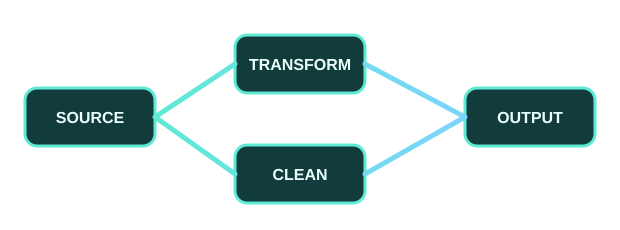

<p align="center">
  
  <br/>
  <br/>   
  <br/>
</p>

## 🧭 Overview

Data Lineage Mini is a dependency-free Node.js CLI that reads a small JSON pipeline manifest and generates a Mermaid flowchart. It also checks for missing dependencies and dependency cycles.

## ✨ Features

- 🧩 Describe pipeline steps with IDs, labels, and dependencies.
- 🗺️ Generate a Mermaid flowchart showing upstream-to-downstream lineage.
- 🚧 Detect references to missing nodes.
- 🔁 Detect dependency cycles and report a cycle path.
- 📦 Use only Node.js built-in modules.

## 🎬 Demo

The included sample describes extract, clean, enrich, report, and archive steps. Run the CLI to print the Mermaid graph and diagnostics. No hosted demo is claimed.

## 🚀 Quick Start

Requires Node.js 18 or newer.

```bash
npm start -- sample/pipeline.json
```

Write the diagram to a file:

```bash
npm start -- sample/pipeline.json --output lineage.mmd
```

## 🧰 Tech Stack

- 🟢 Node.js 18+
- 📄 JSON manifest parsing
- 🧜 Mermaid flowchart output
- 📦 No third-party dependencies

## 🗂️ Folder Structure

```text
data-lineage-mini/
├── assets/mark.svg
├── index.js
├── sample/pipeline.json
├── package.json
├── README.md
├── LICENSE
└── .gitignore
```

## 🛣️ Roadmap

- [ ] Add column-level lineage metadata.
- [ ] Export Graphviz DOT.
- [ ] Add a browser graph viewer.

## 🤝 Contributing

Include a small JSON fixture for every new diagnostic. Keep the manifest format explicit and the graph output deterministic.

## 📄 License

MIT licensed. See [LICENSE](LICENSE).

<p align="center"></p>
